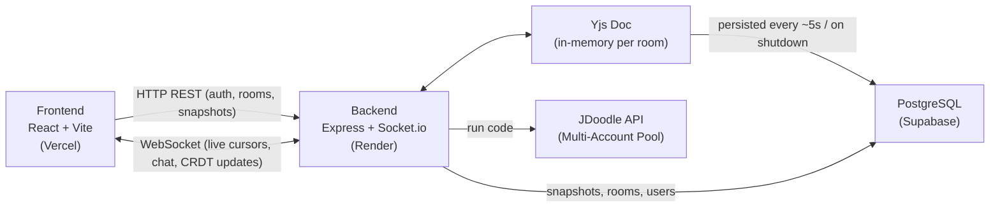

# CodeCollab

Real-time collaborative code editor. Multiple developers edit code simultaneously, see live cursors, chat, and run code — all in the browser.

> VS Code + Google Docs + Online Compiler

**Live Demo:** [code-collab-woad.vercel.app](https://code-collab-woad.vercel.app)

---

## Stack

**Backend:** Node.js, Express, Socket.io, PostgreSQL, Passport.js, JWT  
**Frontend:** React 18, Vite, Tailwind CSS, Monaco Editor, Socket.io Client  
**Real-time Sync:** Yjs CRDT  
**Execution:** JDoodle API (60+ languages) with multi-account rotation and rate-limit cooldown  
**Infra:** Render (backend) · Vercel (frontend) · Supabase (PostgreSQL)

---

## Features

| Feature | Description |
|---------|-------------|
| Real-time editing | Yjs CRDT synced via binary Socket.io frames |
| Remote cursors | Live cursors with color + username labels |
| Editor / Viewer roles | Separate room codes — edit or read-only access |
| Code execution | 60+ languages via JDoodle API with automated account rotation |
| Version history | Manual snapshots + auto-save every 10 min |
| Workspace history | Dedicated "My Rooms" page tracking all past workspaces |
| Integrated chat | In-room messaging with typing indicators + system notices |
| Presence | Color-coded avatars and viewer indicators for all connected users |
| Auth & Onboarding | Email/password verification (Brevo) + Google OAuth with dedicated username setup |
| Password Reset | Brevo HTTP API (bypasses Render SMTP firewalls) with single-use JWTs |
| Production Hardened | Comprehensive SEO, a11y, security headers, and bundle code-splitting |

### Supported Languages (60+)

Languages are organized into categories in the dropdown selector:

| Category | Languages |
|----------|-----------|
| **Popular** | JavaScript, Python 3, Java, C++, C, TypeScript, C#, Go, Rust, Kotlin, Swift, Ruby, PHP, Dart |
| **Scripting** | Bash, Perl, Lua, R, CoffeeScript, Tcl, Octave |
| **Functional** | Haskell, Scala, Elixir, Erlang, Clojure, F#, OCaml, Racket, Scheme, Lisp, SML |
| **Systems** | Assembly (NASM), Objective-C, D, Nim, Zig, Ada, Fortran, Pascal, COBOL |
| **JVM & .NET** | Groovy, VB.NET |
| **Academic** | Prolog, Julia, Crystal, Smalltalk, Factor, Icon, Pike, LOLCODE, Brainfuck, SpiderMonkey |
| **Database** | SQL |

---

## Production Audit & Hardening (20-Point Checklist)

The codebase has undergone a complete production audit covering security, SEO, accessibility, performance, and reliability:

1. **Canonical URLs:** Automatic dynamic canonical tag injection via `usePageMeta` hook across all routes to prevent duplicate-content indexing.
2. **Open Graph & Social Cards:** Comprehensive `og:title`, `og:description`, `og:image`, `og:url`, `og:type`, and Twitter Summary Cards with a dedicated 1200×630 SVG preview image (`og-image.svg`).
3. **Security Headers:** Strict headers configured on both Vercel (`vercel.json`) and Express (`index.js`): Content-Security-Policy (CSP), Strict-Transport-Security (HSTS), `X-Content-Type-Options: nosniff`, `X-Frame-Options: DENY`, `Referrer-Policy: strict-origin-when-cross-origin`, and `Permissions-Policy`.
4. **robots.txt:** Crawler directives indexing public pages (`/`, `/login`, `/privacy`) while preventing crawling of private/authenticated routes (`/room/*`, `/dashboard`, `/setup-username`).
5. **sitemap.xml:** Valid XML sitemap referencing public indexable routes with change frequencies.
6. **Page Titles:** Dynamic document titles adhering to standard branding formats (`<Page> — CodeCollab`), including dynamic room and role titles.
7. **Meta Descriptions:** Curated, unique meta descriptions for public pages with automated `noindex, nofollow` on private rooms and settings.
8. **Alt Text & Accessible Media:** Explicit descriptive alt attributes on all informative images and avatars; decorative graphics marked appropriately.
9. **Internal Links:** Clean navigation graph; fixed dead-ends and improper redirects (e.g., returning to `/dashboard` from room histories).
10. **Custom 404:** Branded client-side 404 page (`NotFound.jsx`) and standardized JSON 404 errors for unmatched API endpoints.
11. **Privacy Policy:** Dedicated privacy page (`/privacy`) describing data practices: Google OAuth, Brevo transactional emails, Supabase persistence, JDoodle execution, Vercel frontend, and Render backend.
12. **HTTPS & Cookie Hardening:** Strict HTTPS enforcement with HSTS (`max-age=63072000`). Session cookies hardened with `HttpOnly`, `Secure` (production), and `SameSite` flags.
13. **Exposed Secrets Prevention:** Environment variables strictly isolated; server-only secrets prevented from bundling into Vite build; verified `.env` files are gitignored.
14. **Mobile Responsiveness:** Flex/grid layouts verified across mobile, tablet, and desktop viewports without layout clipping or horizontal overflow.
15. **Page Speed & Code Splitting:** Rollup `manualChunks` configured in `vite.config.js` splitting Monaco Editor, Three.js/OGL, Yjs, Socket.io, and React into separate chunks — reducing the main entry chunk from **3.89 MB** to **~450 kB** (gzip: ~150 kB).
16. **Working Forms:** Semantic `<label htmlFor>` associations, HTML5 email/password validation, autocomplete attributes, and username length constraints.
17. **Form Feedback & Loading States:** Double-submission prevention, disabled buttons during pending requests (`isSubmitting`), and screen-reader accessible alerts (`aria-live="polite"`).
18. **Clear CTAs:** High-contrast call-to-action buttons with distinct visual hierarchy and keyboard focus rings.
19. **Accessibility (a11y):** `:focus-visible` ring styling, `@media (prefers-reduced-motion)` animation suppression, semantic buttons replacing interactive `div` elements, and `aria-label` tags on all icon-only buttons.
20. **Backend Reliability & Error Handling:** JSON request body limits (`512kb`), global error handling middleware, and graceful shutdown flushing in-memory Yjs documents to PostgreSQL on `SIGTERM`/`SIGINT`.

---

## Local Setup

```bash
git clone https://github.com/codertoji-spec/CodeCollab.git
cd CodeCollab
```

### Backend
```bash
cd backend
cp .env.example .env   # fill in values — JDOODLE credentials required for execution
npm install
npm run dev
```

### Frontend
```bash
cd frontend
cp .env.example .env   # defaults match local backend port
npm install
npm run dev
```

### Environment Variables

**Backend `.env`:**
```
PORT=5000
DATABASE_URL=postgresql://...
JWT_SECRET=your_jwt_secret
SESSION_SECRET=your_session_secret
CLIENT_URL=http://localhost:5173
SERVER_URL=http://localhost:5000
GOOGLE_CLIENT_ID=...
GOOGLE_CLIENT_SECRET=...
JDOODLE_CLIENT_ID=...
JDOODLE_CLIENT_SECRET=...
BREVO_API_KEY=...
EMAIL_USER=...
```

**Frontend `.env`:**
```
VITE_API_URL=http://localhost:5000/api
VITE_SOCKET_URL=http://localhost:5000
```

---

## Deployment

| Service | Platform | URL |
|---------|----------|-----|
| Frontend | Vercel | [code-collab-woad.vercel.app](https://code-collab-woad.vercel.app) |
| Backend | Render | [codecollab-gcgs.onrender.com](https://codecollab-gcgs.onrender.com) |
| Database | Supabase | PostgreSQL (connection pooler) |

---

## Architecture



### Real-time Sync (Yjs CRDT)
- Server maintains one `Y.Doc` per active room in memory.
- Client edits transmit as binary `Uint8Array` frames over WebSocket.
- State persists to PostgreSQL every 5s and flushes on graceful shutdown.
- On join, clients receive full state vector (`yjs-init`).

### Socket Authentication
JWT verified during handshake. `userId` and `username` are extracted from verified token payloads — client-sent identifiers are never trusted.

---

## Project Structure

```
CodeCollab/
├── backend/
│   └── src/
│       ├── index.js                 # Server entry, security headers, Socket.io, graceful shutdown
│       ├── controllers/
│       │   ├── authController.js    # Auth, OTP, Google OAuth, username setup
│       │   ├── executeController.js # Code execution endpoint
│       │   └── roomController.js    # Room CRUD, snapshots
│       ├── routes/                  # Express REST routes
│       ├── services/
│       │   ├── executionService.js  # JDoodle multi-account rotation
│       │   ├── langConfig.js        # Language configurations & aliases
│       │   └── yjsManager.js        # Yjs document management & persistence
│       └── middleware/              # Auth & security middleware
├── frontend/
│   ├── public/
│   │   ├── og-image.svg             # 1200x630 social preview card
│   │   ├── robots.txt               # Crawler directives
│   │   └── sitemap.xml              # XML sitemap
│   └── src/
│       ├── pages/
│       │   ├── Landing.jsx          # Hero page with WebGL shaders & ParticleText
│       │   ├── Dashboard.jsx        # Workspace creation & recent rooms
│       │   ├── MyRooms.jsx          # Full user workspace history
│       │   ├── Room.jsx             # Collaborative editor with Monaco & terminal
│       │   ├── Login.jsx            # Authentication form
│       │   ├── SetupUsername.jsx    # Post-OAuth username selection
│       │   ├── ResetPassword.jsx    # Password recovery flow
│       │   ├── PrivacyPolicy.jsx    # Application privacy policy
│       │   └── NotFound.jsx         # Custom 404 page
│       ├── hooks/
│       │   └── usePageMeta.js       # Dynamic SEO, title, and canonical hook
│       ├── components/              # UI components (VersionHistory, WarpText, etc.)
│       ├── context/AuthContext.jsx   # Global auth state management
│       └── utils/                   # Languages, icons, and formatting utilities
└── README.md
```

---

## Socket Events

| Event | Direction | Description |
|-------|-----------|-------------|
| `join-room` | C→S | Join room with role code |
| `room-state` | S→C | Initial language and active user roster |
| `yjs-init` | S→C | Complete Yjs CRDT state on initial join |
| `yjs-update` | C↔S | Binary CRDT document patch |
| `users-update` | S→C | Active participants list update |
| `language-change` | C↔S | Synchronized language switch |
| `cursor-move` / `cursor-update` | C↔S | Remote multi-cursor coordinate broadcast |
| `chat-message` | C↔S | In-room messaging |
| `typing` / `typing-update` | C↔S | Typing indicator broadcast |
| `execution-result` | C↔S | Real-time code execution output |

---

## Testing

```bash
cd backend && npm test
```

| Suite | Description |
|-------|-------------|
| `auth.test.js` | Token verification, caching, and unauthorized rejections |
| `executionService.test.js` | Multi-account JDoodle failover, rate-limit cooldown, and error parsing |
| `yjsManager.test.js` | CRDT document persistence, concurrency roundtrips, and room cleanup |
